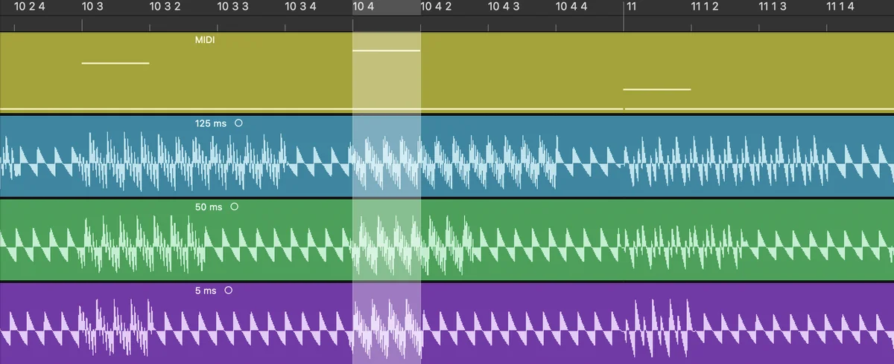

# matriarch-firmware-fixes

Unofficial bug fixes for the Moog Matriarch firmware v1.3.0, the last release before the Matriarch was discontinued.

> **Unofficial. Use at your own risk.** This project isn't affiliated with or endorsed by Moog Music. Flashing modified firmware may void your warranty, and the authors take no responsibility for any damage. This repository contains no Moog firmware. You patch your own copy of Moog's official v1.3.0 file.

## Fixes

| Fix                                             | Web patcher | Script                   | Status                                            |
| ----------------------------------------------- | ----------- | ------------------------ | ------------------------------------------------- |
| Paraphonic Mixer Gate Length                    | Yes         | `tools/patch_mixgate.py` | Tested on hardware (5 ms and 50 ms)               |
| HOLD sends sustain while the Arp/Seq is playing | Yes         | `tools/patch_holdcc.py`  | Tested on hardware, with a Yamaha DX7 on MIDI out |

### Paraphonic Mixer Gate Length

Moog's v1.3.0 known-issues list says: _"Paraphonic Mixer Gate Length - Mixer gate can stay high longer than keys are pressed."_

In 2- and 4-note paraphonic mode, releasing a key while another key is still held keeps that oscillator sounding for another **125 ms**. Staccato notes over a held note, or fast playing where keys overlap, smear together (see the Moog forum thread "Matriarch - staccato playing in paraphonic modes"). The patch shortens the hold:

- `--ms 5`: released notes stop almost immediately (recommended)
- `--ms 50`: the v1.1.0 behaviour

When the _last_ key is released, the VCA envelope's release shapes the tail exactly as before.

[](web/audio-test.webp)

_The same MIDI part recorded on a Matriarch with the original firmware (125 ms), then with each patch (50 ms and 5 ms): a held note with short notes on top. The highlighted note ends at the same point in all three. With 125 ms it keeps sounding well past the end, with 50 ms the tail is shorter, and with 5 ms it stops where the note ends._

### HOLD sends sustain while the Arp/Seq is playing

Moog's v1.3.0 known-issues list says: _"ARP sends Sustain CC while Hold is active - HOLD should send sustain CC when Arp/Seq is inactive."_

Since the v1.2 updates, HOLD latches the Arp/Seq when it's running and works as a sustain pedal when it isn't, sending MIDI CC 64. Firmware v1.3.0 sends CC 64 in both cases, so latching an arpeggio also sustains every note on connected gear. With the fix, connected gear sustains exactly when HOLD is on and the Arp/Seq isn't running:

| You do this                        | v1.3.0 sends                      | Patched sends                                 |
| ---------------------------------- | --------------------------------- | --------------------------------------------- |
| HOLD on, Arp/Seq stopped           | Sustain on                        | Sustain on                                    |
| HOLD on while the Arp/Seq plays    | Sustain on                        | Nothing, and the pattern latches as before    |
| Start the Arp/Seq while HOLD is on | Nothing, so notes keep sustaining | Sustain off, unless the sustain pedal is down |
| Stop the Arp/Seq while HOLD is on  | Nothing                           | Sustain on                                    |
| HOLD off                           | Sustain off                       | Sustain off                                   |

The Matriarch's own sound, the sustain pedal and incoming MIDI sustain work exactly as before. Without the patch there's a workaround: after latching with HOLD, press and release the sustain pedal. That sends sustain off while the pattern stays latched.

## How to patch and flash

You need Moog's official **v1.3.0** firmware (`Matriarch_Firmware_v1_3_0.syx`), which comes with the Moog Firmware Updater or Moog's v1.3.0 download.

### In your browser (easiest)

Open the **[Matriarch Firmware Patcher](https://benjamindehli.github.io/matriarch-firmware-fixes/)**, choose your firmware file, pick the fixes, and download the patched file. Everything runs locally in your browser. Your file is never uploaded. The page then shows how to flash the patched file.

### On the command line

You need Python 3.

1. Create the patched file:
   ```sh
   python3 tools/patch.py Matriarch_Firmware_v1_3_0.syx Matriarch_Firmware_v1_3_0_patched.syx --mixgate 5 --hold
   ```
   Leave out `--mixgate` or `--hold` to apply only one of the fixes. The script refuses to patch anything that isn't unpatched v1.3.0.
2. Flash it with a SysEx tool (SysEx Librarian on macOS, Bome SendSX on Windows), following Moog's normal procedure:
   1. Send `Matriarch_FIRMWARE_INVALIDATE.syx`.
   2. Re-select the Matriarch as the MIDI output (it reboots).
   3. Send `Matriarch_FIRMWARE_ERASE.syx`.
   4. Send the patched file.
3. To go back to stock, repeat step 2 with Moog's original `Matriarch_Firmware_v1_3_0.syx`.

Use a direct USB cable (no hub) and don't touch the synth during the transfer. If a transfer fails, power-cycle, reconnect, and start again from INVALIDATE. The updates never touch the bootloader.

## How the fixes work

### Paraphonic mixer gate length

Note-off (`0x88de4`) doesn't close a released voice's mixer gate immediately when other keys are held. It marks the voice as release-pending with a timestamp, and the main loop (`0x8a56b`, at `0x8a81d`) closes the gate once `now - timestamp > engine.mixGateDelay`. The engine init (`0x8b3f0`) sets that delay:

```
0008b98f  8d00 0ef4   MOVL XAR0,#0xef4
0008b991  8f01 e848   MOVL XAR4,#0x1e848      ; 125000 us   <- the patch rewrites this immediate
0008b994  a893        MOVL *+XAR3[AR0],XAR4   ; engine(0x10640).mixGateDelay
```

Only the release loop reads the field, and the setter at `0x88efc` is never called. The patch changes two 16-bit words. All other bytes of the `.syx` stay identical to Moog's, and the affected record's checksum is recomputed.

History, from comparing v1.1.0, v1.2.3 and v1.3.0:

| Version | Mixer gate hold after key-up                       | Multi Trig envelope retrigger window |
| ------- | -------------------------------------------------- | ------------------------------------ |
| v1.1.0  | 50 ms (`deadline = ts + 0xC350` at `0x8a6e3`)      | 2 ms                                 |
| v1.2.3  | 125 ms (moved to `engine+0xEF4`, set at `0x8b901`) | 4 ms                                 |
| v1.3.0  | 125 ms                                             | 5 ms                                 |

The 125 ms change isn't in any release notes. Moog support has said the hold is intentional, "to avoid completely missing quickly played notes". The Multi Trig retrigger window (the stuck-envelope fixes in v1.2.x) is separate code with its own constant and isn't affected by this patch.

### HOLD and sustain

The HOLD button handler (`0x8c5a5`) sets the HOLD parameter, then calls the shared sustain routine `0x8c56b(on, send)`. That routine sets the keyboard sustain state and, when `send` is set, sends CC 64 through the MIDI output (`0x97037`). The handler sets `send` from the global "MIDI Out Filter - Keys" without looking at the Arp/Seq:

```
0008c5b8  9224        MOV  AL,@0x24          ; 0xc8a4 = "MIDI Out Filter - Keys"
0008c5ba  56b0 01a8   MOVB @AH,#0x1,NEQ      ; AH = send CC 64
0008c5bc  92a6        MOV  AL,@AR6           ; AL = new HOLD state
0008c5bd  7648 c56b   LCR  0x0008c56b        ; <- redirected to 0xa2000
```

The patch adds two short routines in empty flash at `0xa2000`, after the last data in sector H (`0xa1c3f`). The first clears `send` when HOLD is switched on while the Arp/Seq is playing (`0xe4c0 + 0x3f`), then jumps into Moog's routine. The second wraps the Arp/Seq start/stop routine `0x90b88`, which only the PLAY parameter's handler calls, and resyncs CC 64 when the Arp/Seq starts or stops while HOLD is on. The full disassembly is in `tools/patch_holdcc.py`.

Two details matter. The Arp/Seq latch (`0xe4c0 + 0xa5`) can't be used, because the HOLD parameter's handler that sets it runs later from an event queue. And the new code is covered by the firmware checksum without any extra work, because the Matriarch computes that checksum itself after an update.

## Firmware format and hardware notes

- The firmware is a single SysEx message `F0 04 17 ... F7`. Each 16-bit word is packed into 3 bytes (`0x40|b15..12`, `b11..6`, `b5..0`).
- Data records are `0013 0088 0080 0000 addrLo addrHi cksum <128 words> 0000`, where cksum is the 16-bit sum of the other words. The header record (`0012 ...`) holds the version and its own checksum at word 14. The file has no whole-image checksum. After an update, the Matriarch computes a 32-bit sum of the application area itself (`0x99f30`) and stores it at `0xBFFFC`.
- The CPU is a TI TMS320F2837x (C28x + FPU), which is word-addressed. The application lives at `0x88000` to `0xBFFFF`, and the bootloader sits below it and isn't part of updates.
- Global settings sit at `0xC899 + n` for SysEx global parameter `n` (v1.3.0). For example, paraphony mode is at `0xC8D0`.
- Front-panel LEDs and other digital outputs go through a shift-register shadow at `0x1374A`, flushed over SPI.
- Panel parameters are described in a table at `0x9F380` (10 words each: ID, type, RAM address, handler). Setting one stores the value at once and posts its handler to an event queue at `0xF400`, so the handler runs after the code that set it.
- The flash erase and program routines only run during a firmware update, which erases sectors E to N. Nothing at runtime erases the application's sectors.

## Tools

| File                     | Purpose                                                                                                                                                                                                                                             |
| ------------------------ | --------------------------------------------------------------------------------------------------------------------------------------------------------------------------------------------------------------------------------------------------- |
| `tools/matriarch_syx.py` | Parses `.syx` files, verifies checksums and patches words in place                                                                                                                                                                                  |
| `tools/patch.py`         | Applies one or more fixes (`--mixgate MS`, `--hold`)                                                                                                                                                                                                |
| `tools/patch_mixgate.py` | The mixer gate fix                                                                                                                                                                                                                                  |
| `tools/patch_holdcc.py`  | The HOLD sustain fix, with its disassembly                                                                                                                                                                                                          |
| `tools/syx2bin.py`       | Extracts a flat image to load at word address `0x88000`                                                                                                                                                                                             |
| `tools/periph_map.py`    | Shows which functions touch which peripherals (from `refs.tsv`)                                                                                                                                                                                     |
| `tools/ghidra_scripts/`  | `ExportDecomp.java` (decompiled C + references), `DumpListing.java` (listings) and `AssemblePatch.java` (assembles C28x instructions with the processor module's assembler)                                                                         |
| `tools/listing.sh`       | Dumps a listing from a local Ghidra project in `work/ghidra`                                                                                                                                                                                        |
| `web/`                   | The website with the web patcher (`index.html`, `style.css`, and `matriarch-syx.js` and `fixes.js`, JavaScript ports of the Python tools), plus `404.html`, `robots.txt`, `sitemap.xml`, `llms.txt`, the Markdown mirror `index.html.md` and images |
| `tests/`                 | Tests for both patchers against Moog's official v1.3.0 file, with expected hashes in `expected.json`                                                                                                                                                |

The analysis setup is Ghidra 12.1.2 with the [ghidra-tms320c28x](https://github.com/outlandnish/ghidra-tms320c28x) processor module. Import the image from `syx2bin.py` as raw binary with language `TMS320C28x:LE:32:default` and base address `0x88000`, then run the module's `SetupF28377D.java CPU1` and `SeedFunctions.java` before auto-analysis.

## Development

Python code is linted and formatted with [Ruff](https://docs.astral.sh/ruff/) (config in `pyproject.toml`). Markdown and JSON are formatted with [Prettier](https://prettier.io/) (config in `.prettierrc.json`). Editors that support [EditorConfig](https://editorconfig.org/) pick up the basic settings for all files from `.editorconfig`.

```sh
pip install ruff
ruff check .          # lint
ruff format .         # format Python

npm install
npm run format        # format Markdown, JSON, HTML and JavaScript
```

The tests need Moog's official v1.3.0 file. Point `MATRIARCH_FIRMWARE` at it (the tests are skipped otherwise):

```sh
export MATRIARCH_FIRMWARE=/path/to/Matriarch_Firmware_v1_3_0.syx
python3 -m unittest discover -s tests -v
npm test
```

They check that both patchers produce files byte-identical to the builds tested on hardware. To try the web patcher locally, serve the `web/` folder (`python3 -m http.server -d web`) and open `http://localhost:8000`. It doesn't work when opened directly as a file.

The `CI` workflow (`.github/workflows/ci.yml`) runs the linters and tests on every push and pull request. For the tests, it downloads Moog's official firmware from the URL their own updater uses. The file is only used for testing and is never published. When everything passes on `main`, the workflow deploys `web/` to GitHub Pages.

## Releases

Release notes live in `release-notes/`, one file per version (`release-notes/v1.0.0.md`). The first `# ` heading becomes the release title and the rest becomes the release description. To publish a release, add the notes file, commit it, then push a matching tag:

```sh
git tag v1.0.0
git push origin v1.0.0
```

The `Release` workflow (`.github/workflows/release.yml`) then creates the GitHub release from the notes. Running it again for an existing release updates the notes.

## License

Copyright (C) 2026 Benjamin Dehli

The tools and documentation in this repository are free software, licensed under the [GNU General Public License v3.0 or later](LICENSE). Moog Music's firmware isn't included and isn't covered by this license.
